# scientific-figure-design

実験心理学・神経科学・生物データ解析の研究図を作成・レビューするためのCodexスキルです。読者に何を比較してほしいかを起点に、図種、パネル配置、軸、凡例、figure legend（図説明）を決めます。

論文用の図、研究発表スライドに載せる図、単体で読める画像に対応しています。図中の文言とfigure legendは英語で作成します。書体や線はNature系の研究図にそろえ、文字の大きさと情報量は用途に合わせます。

## インストール

Codexのチャットに次の依頼を貼り付けてください。

```text
$skill-installer https://github.com/H1S4G10rc4/fig_skill/tree/main/outputs/scientific-figure-design にあるスキルをインストールしてください。
```

macOS・Linuxでターミナルからインストールする場合は、Codex付属のインストーラーを使えます。

```bash
python3 "${CODEX_HOME:-$HOME/.codex}/skills/.system/skill-installer/scripts/install-skill-from-github.py" \
  --repo H1S4G10rc4/fig_skill \
  --path outputs/scientific-figure-design
```

どちらも、標準の設定では `~/.codex/skills/scientific-figure-design/` に本体・参考資料・作例をまとめて配置します。

## 使い方

データファイルや既存の図を添付し、`$scientific-figure-design` に続けて「比べたいこと」と「図の用途」を指定します。参加者・動物・ドナーを識別する列や、同じ標本をどの条件で測定したかを伝えると、個体内の変化を図に反映できます。

**論文用の図を作る**

```text
$scientific-figure-design 添付のERPデータから、Pzの標準刺激と標的刺激の波形を比較してください。参加者IDで条件を対応づけ、刺激後300–500 msの平均振幅の参加者内差も示してください。Nature本誌の1段幅のPDFと英文のfigure legendが必要です。
```

**単体で読める画像を作る**

```text
$scientific-figure-design この発現量データは同じドナーの対照と刺激後のTPMです。遺伝子ごとの刺激応答がドナー間でどの程度そろうかを、1枚のPNGにしてください。ドナー数、色の意味、比の向きが画像だけで分かるようにしてください。
```

**既存の図を研究発表用に直す**

```text
$scientific-figure-design 添付した反転学習の図と正答率データを使って、研究室の口頭発表用に描き直してください。どのセッションで報酬規則が変わったかと、同じマウスがその後どう回復したかを見せたいです。
```

## 作例

以下はすべて架空データです。各題材の「スキルなし」と「スキルあり」には同じ測定値を使っています。

### 反応時間

同じ6人について、手がかりなし・ありの正答試行の反応時間中央値を比較します。スキルなしの図表では2条件の値を、スキルありの図表では各参加者の値と条件差を同じ行で読めます。

| スキルなし | スキルあり |
|---|---|
| 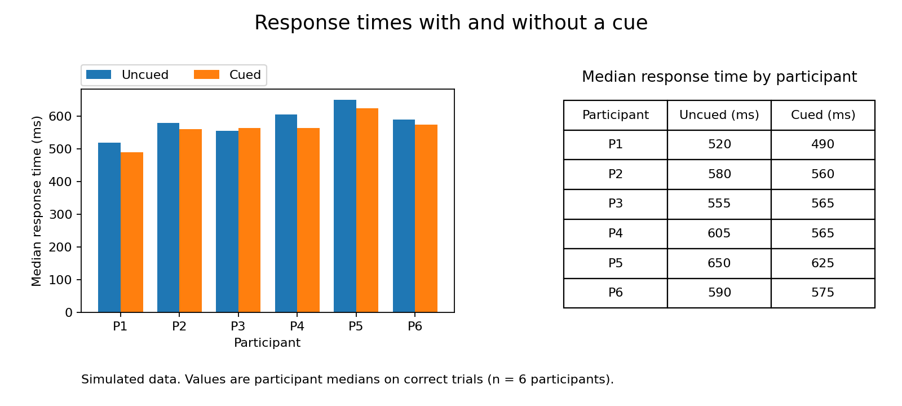 | 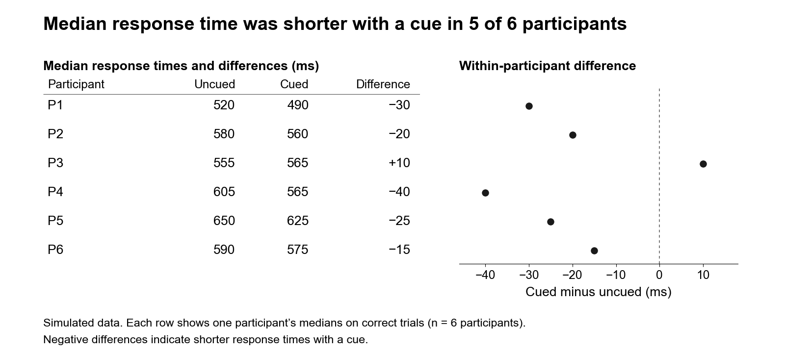 |

同じデータを、論文・研究発表・単一画像の3用途に展開した例です。論文図には元の反応時間と差の両方を載せ、口頭発表では差を大きく示し、単一画像には標本数と読み方を含めています。

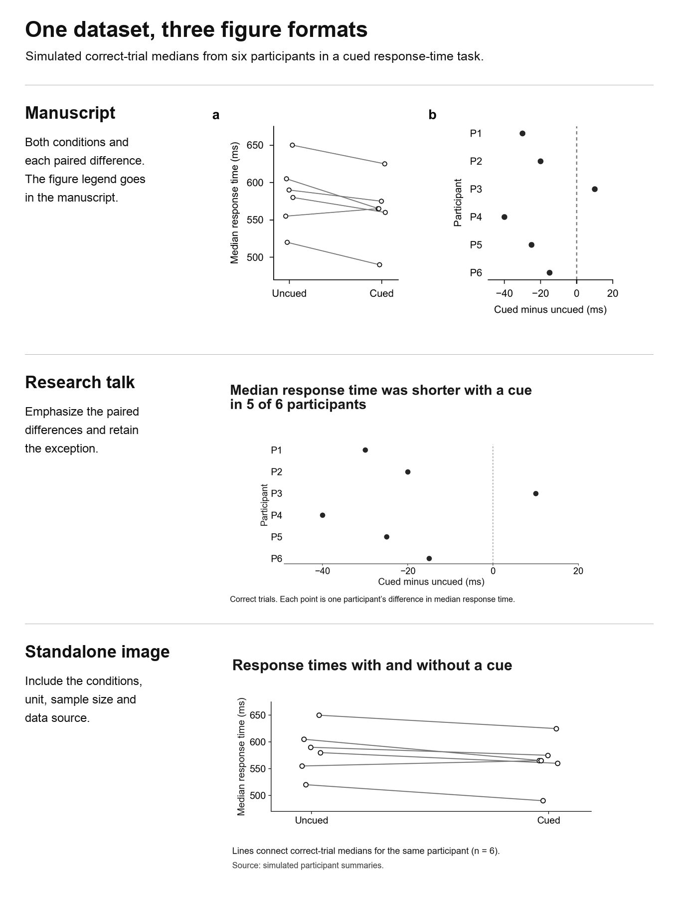

### ERP波形

標準刺激と標的刺激の総加算平均を比べます。スキルありの論文図では、比較に使った300–500 msを網掛けし、その時間窓の参加者内差を隣に示しました。以下の3分野の比較画像はいずれも、上段が論文用、下段が単一画像用です。

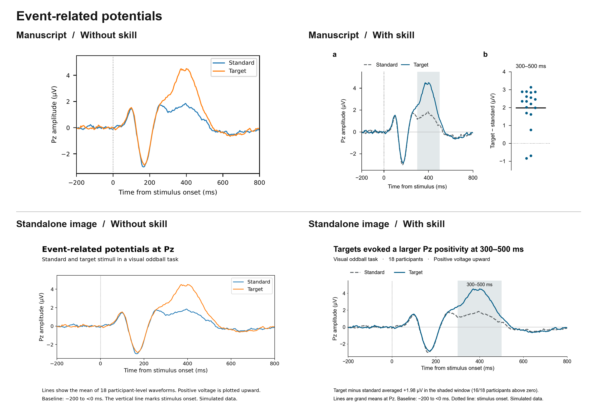

| 単一画像・スキルなし | 単一画像・スキルあり |
|---|---|
| 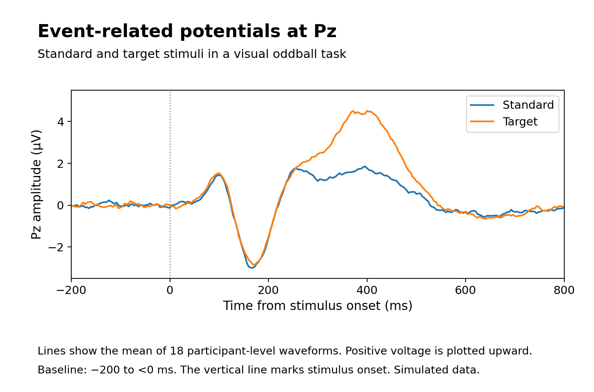 | 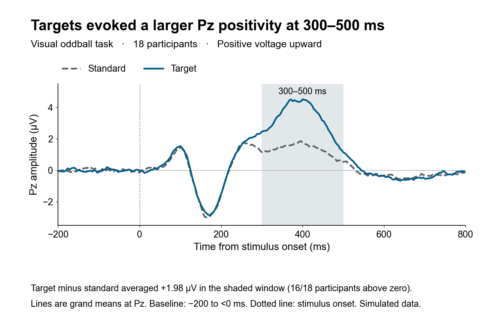 |

### 遺伝子発現

8人のドナーに由来する神経細胞培養を例に、6遺伝子の発現を比較します。左は各試料の発現量、右は同じドナーにおける刺激時と対照時の発現比です。たとえばGAPDHは発現量が多く、刺激による変化は小さいことが両方の図から読み取れます。

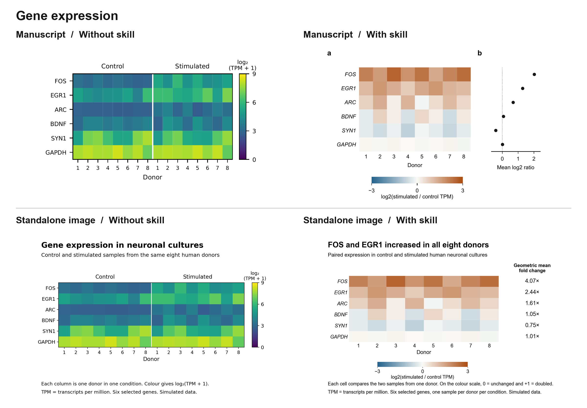

| 単一画像・スキルなし | 単一画像・スキルあり |
|---|---|
| 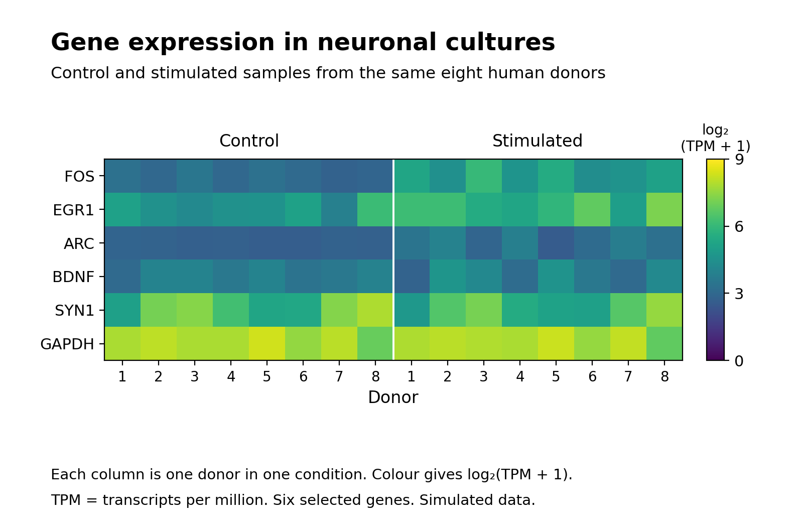 | 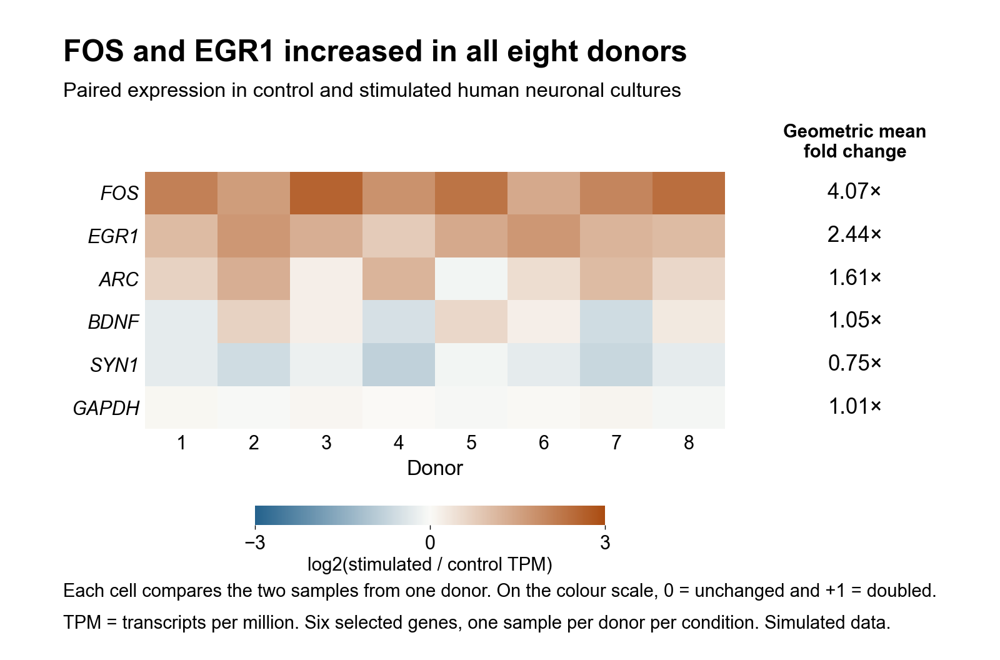 |

### マウスの反転学習

同じ8匹が二択課題を10セッション行い、第6セッションの前に報酬規則が反転した例です。群平均と標準誤差を示した棒グラフに対し、個体を線で追う図では、反転後の回復の速さも読み取れます。

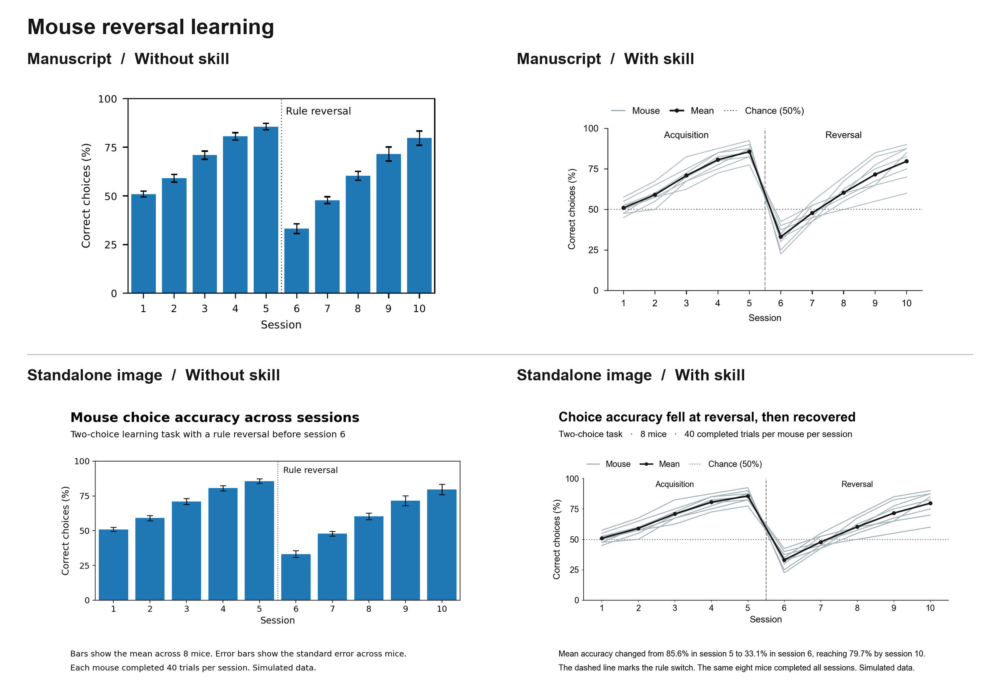

| 単一画像・スキルなし | 単一画像・スキルあり |
|---|---|
| 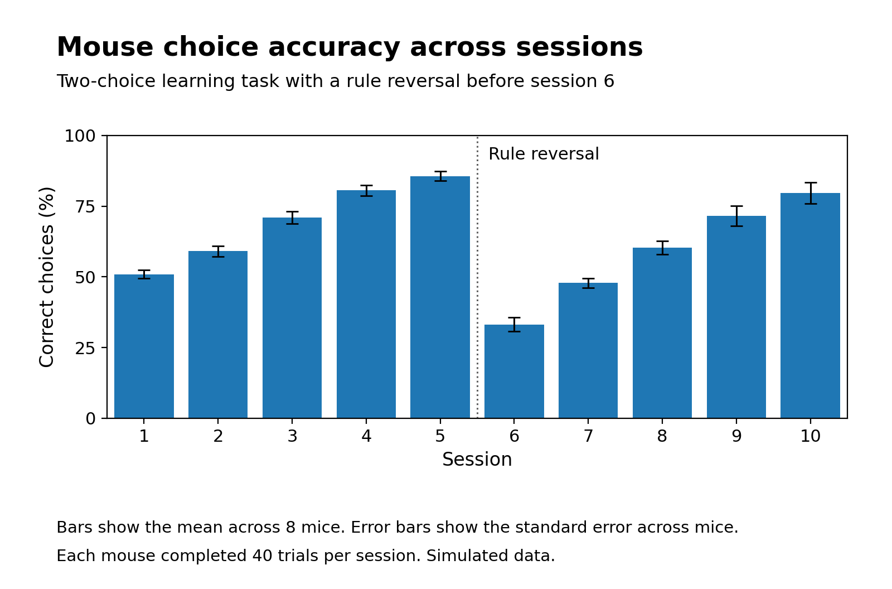 | 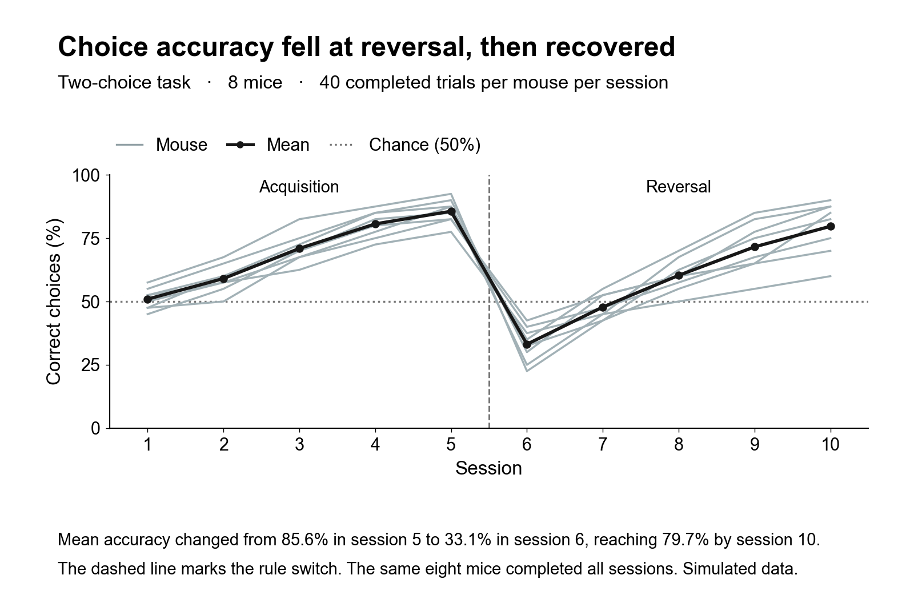 |

ERP・遺伝子発現・マウス行動の論文図は、英文のfigure legendと原寸のベクター図版でも確認できます。PDFの1–3ページが左右の比較と図説明、4–9ページが幅89 mmの図版です。[論文用PDFを開く](outputs/scientific-figure-design/assets/field-examples/manuscript-figures.pdf)

## 作図の参考資料

- [データの種類と研究上の問いから図を選ぶ](outputs/scientific-figure-design/references/design-decisions.md)
- [eLife・Nature系列の7報から8図を読み解く](outputs/scientific-figure-design/references/paper-examples.md)
- [Nature本誌の初回投稿・最終入稿・Extended Dataの仕様](outputs/scientific-figure-design/references/nature-artwork.md)
- [論文・研究発表・単一画像の作り分け](outputs/scientific-figure-design/references/output-variants.md)
